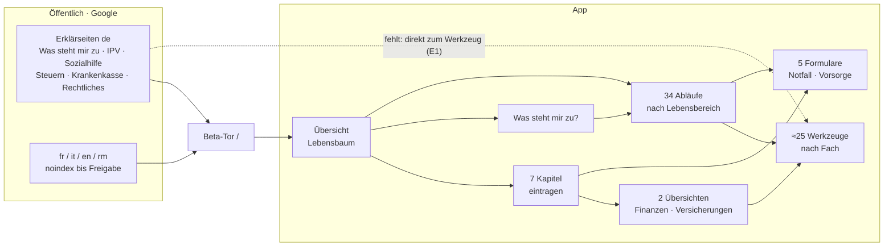

# Seitenlandkarte · alle Seiten durchgegangen (05.11.2026)

*Gemessen 05.11.2026 abends auf `main` = `40e61e29` (lokal, Arbeitsbaum `_werkbank/seiten-durchgang`)
und live `malojaplana.ch` (Stand Deploy `4f37d580`). Blatt auf Zweig `docs/seitenlandkarte`.
Entscheid: Stebler Studios. **Nichts gebaut, nichts geändert. Hier stehen nur Befund und Vorschläge.***

Baut auf [`seiten-buendeln.md`](seiten-buendeln.md) auf. Die dort entschiedenen und gebauten Bündelungen
(Charts, Ausgesteuert, Notfall-Einstieg, Unterlagen, Mahnung + Betreibung, Importe, Merkliste, Dossiers,
Versicherungs-Übersicht) werden hier **nicht** neu vorgeschlagen.

---

## 1 · Was durchgegangen wurde, und mit welchem Ergebnis

### Öffentliche Erklärseiten (live, `curl`)

| Was | Ergebnis |
|---|---|
| Seiten | 33 Adressen: Start, 6 deutsche Erklärseiten, je 5 in fr/it/en/rm, 5 «bewegte Fassungen» Krankenkasse, Kantone im Vergleich |
| Antwort | 32 × 200. **`/kantone-im-vergleich/` = 404 live** → erwartet, #683 ist gemergt (20:59), nicht deployed |
| Sprache | `lang` stimmt auf jeder Seite (de/fr/it/en/rm) |
| Indexierung | de: `index, follow`. fr/it/en/rm: `noindex` (gewollt bis zur Freigabe, siehe Übersetzungs-Prüfung). Bewegte Fassungen: `noindex`, ohne `canonical` |
| Links | 83 verschiedene Links aus allen Seiten: **81 × 200**. 2 × 403 auf `admin.ch/de/newnsb/…` (Seite Krankenkasse). admin.ch weist **jede** Abfrage ohne Browser mit 403 ab, auch die Startseite und eine erfundene Adresse. Das ist also kein Befund. Im Browser nicht gemessen, weil der Browser-Zugriff abgelehnt wurde |

### App-Ansichten (lokal, Browser, Beispiel-Modus «Maria Muster»)

| Was | Ergebnis |
|---|---|
| Adressen | alle 91 Schlüssel aus `VALID_VIEWS` + `#/chapter/0…9` = 101 Aufrufe |
| Fehler | **0** abgefangene Fehler (`console.error`, `error`, `unhandledrejection`), keine Fehlerseite |
| Umleitungen | alle 13 aus `UMLEITUNGEN` landen am richtigen Ziel |
| Leere Seiten | keine. Kürzeste: Export (309 Zeichen), weil der Export im Beispiel-Modus gesperrt ist (gewollt) |

**Nicht geprüft:** 375 px, Bedienung der Formulare und Rechner, eigene Daten statt Beispiel, Dunkel/Hell, Vorlesen.
Der Durchgang zeigt: *jede Seite öffnet ohne Fehler*. Ob sie *richtig rechnet*, zeigt er nicht.

### Kleinbefunde

| # | Befund | Gewicht |
|---|---|---|
| K1 | `#/chapter/7`, `/8`, `/9` (es gibt nur 0–6) zeigen still das Kapitel Notfall, die Adresse bleibt falsch | klein. Nur bei getippten Adressen |
| ~~K2~~ | ⟨**korrigiert 05.11., kein Befund**⟩ ~~hreflang ohne Selbstverweis, `x-default` fehlt~~. Gemessen hatte ich die `hreflang`-Attribute der **Links im Sprachumschalter** (`<a hreflang>`). Diese lassen die aktive Sprache naturgemäss weg. `<link rel="alternate" hreflang>` gibt es live auf **keiner** Seite, und das ist gewollt: `hreflangRing()` in `scripts/build-seiten.mjs` schreibt den Ring erst, wenn mindestens zwei Sprachen freigegeben sind, und dann **mit** Selbstverweis und `x-default`. Heute ist nur `de` frei | keiner. Die Zahl beschrieb das Messgerät |
| K3 | Die Erklärseiten verlinken die App nur über `/`, also über das Beta-Tor. Wer «Sozialhilfe» liest, landet nicht beim Sozialhilfe-Rechner | Ergänzen, siehe §3 E1 |
| K4 | Die Seite Krankenkasse ist nur deutsch, die Kantone im Vergleich ebenso. Von den Sprachseiten führt kein Weg dorthin | bewusst (Weg A, Krankenkasse zuerst), notiert |

---

## 2 · Die Karte: wo was liegt, und warum

Maloja hat **fünf Arten von Seiten**. Die Art bestimmt den Ort. Daraus folgt die Regel für jede neue Seite.

| Art | Wozu | Wo man hinkommt | Zahl |
|---|---|---|---|
| **Kapitel** | eintragen, was man hat | Lebensbaum, Übersicht | 7 |
| **Übersicht** | alles zu einem Bereich auf einen Blick, mit Wert je Zeile | aus dem Kapitel («Passend», ganz oben) | 2: Finanz-Auswertung (im Kapitel Finanzen), Versicherungs-Übersicht |
| **Ablauf** | «es ist etwas passiert, was tun?»: Schritte, Fristen, Quellen | Übersicht (Lebensereignisse), Suche, Rucksack, verwandte Abläufe | 34 (`ABLAEUFE`) |
| **Werkzeug / Rechner** | rechnen, prüfen, erzeugen | Leiste, Fächer (Geld · Gesundheit · Alter · Aussenfach), Suche, Übersicht-Zeilen | ≈ 25 (`WERKZEUGE` + Suche) |
| **Formular** | «halte deins fest»: Patientenverfügung, Bestattung, Organspende, Notfallkarte, Notfallpass | aus dem Kapitel Notfall (Block Vorsorge) und dem passenden Ablauf | 5 |
| *Rahmen* | Suche, Einstellungen, Benachrichtigungen, Rechtliches, Installieren, Flyer, Export, Rucksack, Obstgarten | Kopf, Menü, Einstellungen | 9 |

### Die 34 Abläufe nach Lebensbereich (so stehen sie in `ABLAEUFE`)

| Bereich | Abläufe |
|---|---|
| Arbeit | Neuer Job · Stelle verloren (mit Ausgesteuert) · Selbständig werden · Lehre beginnen |
| Familie | Heirat · Kind bekommen · Trennung · Adoption · Todesfall |
| Wohnen | Umzug · Wohnung gekündigt · Zusammenziehen |
| Finanzen | Mahnung oder Zahlungsbefehl (2 Adressen, 1 Seite) · Ihnen schuldet jemand Geld · Quellensteuer · Betreibungsauszug |
| Versicherungen | Krankenkasse zum ersten Mal · Krankenkasse wechseln (mit Zusatz) |
| Gesundheit | Unfall oder Krankheit · Krankheit & IV · Angehörige pflegen |
| Vorsorge | Pensionierung · Ergänzungsleistungen · Vorsorgeauftrag und Patientenverfügung |
| Behörden | Bewilligung verlängern · Führerausweis · Asyl · Neu in der Schweiz · Einbürgerung · Wegzug · Pass/ID erneuern · Militär- oder Zivildienst |
| Person | 18 werden · Digitale Ordnung |

### Wie gut jede Seite erreichbar ist

Gezählt sind die Dateien in `src/`, die die Seite als Ziel nennen (ohne Router, Register, Tests, Texte). Die Zahl ist grob.
Sie zeigt aber, welche Seiten **fast nur über Suche oder Menü** gefunden werden:

- **schwach angebunden (≤ 2):** Benachrichtigungen (0), Obstgarten (1, nur Übersicht), Einstellungen (1), Digitale Ordnung (2),
  Unterlagen drucken (2), Flyer (2), Rucksack (2), Kreditkarte (2), Stundenlohn (2)
- **«Nach Einkommen» (`anspruchcheck`)** steht in **keinem** Register (nicht im Menü, nicht in der Suche). Erreichbar nur über
  drei Seiten: Was steht mir zu, Ergänzungsleistungen, Anspruchs-Landkarte. ⟨06.11.: gewollt, siehe Z1⟩
- **stark angebunden (≥ 20):** Prämienverbilligung (30), Vorsorge-Rechner (30), Ablage (25), Steuern (24), Sozialhilfe (20)

---

## 3 · Vorschläge: zusammenlegen · ergänzen · verbessern

Empfehlung je Punkt mit Grund. Gleiche Regeln wie in `seiten-buendeln.md` §5: alte Adresse → `UMLEITUNGEN`,
Texte in fünf Sprachen, Fachprüfung wo Fachtext wandert, Entwurfs-PR, kein Merge und kein Deploy ohne Stebler Studios.

### Zusammenlegen

| | Vorschlag | Warum | Empfehlung |
|---|---|---|---|
| ~~**Z1**~~ | ⟨**entfällt, 06.11.**⟩ ~~«Nach Einkommen» in «Was steht mir zu?»~~. Am Code geprüft: «Was steht mir zu?» **ist seit 27.10. schon die eine Seite** (F7-A3, Entscheid O): Mit Ihren Angaben (Pegel), Nach Ihrer Lebenslage, Weitere Wege. «Nach Einkommen» (`anspruchcheck`) ist der **geführte Weg Schritt für Schritt** durch dieselben Teile. Er ist bewusst eine eigene Seite und **bewusst nur von dort erreichbar** («Lieber Schritt für Schritt?», Code-Kommentar in `Lebenssituationen.jsx` und `AnspruchCheck.jsx`). Dass er in keinem Register steht, ist also gewollt und keine Lücke | — | entfällt. Offen wäre nur, ob der geführte Weg ganz wegfällt. Empfehlung: **nein**, er ist die ruhige Form für Menschen, die sich nicht durch eine lange Seite arbeiten wollen |
| **Z2** | **Benachrichtigungen als Teil der Einstellungen** | 0 Verweise. Steht schon im Fach «Einstellungen». Eine eigene Seite für einen Schalterblock | ja, klein |
| **Z3** | **Notfallpass als aufklappbarer Teil im Kapitel Notfall** | in `seiten-buendeln.md` §8 als «eigener Schritt» offen gelassen. Der Pass steht im Kapitel schon oben als Weg | eher nein. Der Pass ist ein Ausgabe-Werkzeug (Felder fürs Telefon), so begründet am 24.10. Nur auf Wunsch |
| **Z4** | **Obstgarten + Rucksack** als ein Ort «Mein Weg» | beide zeigen den eigenen Fortschritt bzw. das Mitgenommene, beide nur über die Übersicht erreichbar | **offen, nicht entscheiden ohne Gamification-Blatt** (01.11.). Hier nur notiert |

**Ausdrücklich nicht zusammenlegen** (gleiche Begründung wie C und G am 24.10.: verschiedene Sachen hinter ähnlichen Namen):
Pass/ID und Führerausweis · Pensionierung, Vorsorge-Rechner und Ergänzungsleistungen · die fünf Migrations-Abläufe ·
Heirat und Zusammenziehen (Ehe ≠ Konkubinat, darin liegt der Inhalt).

### Gruppieren statt zusammenlegen

| | Vorschlag | Warum |
|---|---|---|
| **G1** | **«Neu in der Schweiz»** als Gruppe in der Übersicht: Zuzug → Krankenkasse zum ersten Mal → Bewilligung → Quellensteuer → später Einbürgerung | 5 Abläufe aus drei Bereichen, die eine Person nacheinander braucht. Die Verweise gibt es teils schon (`ablaufVerwandte.js`) |
| **G2** | **«Mit 18»**: 18 werden → Dienst → Lehre → Neuer Job → Krankenkasse | `volljaehrig` verweist schon auf Dienst und Lehre. Als sichtbare Reihe in der Übersicht |
| ~~**G3**~~ | ⟨**entfällt, 06.11.**⟩ ~~«Wenn jemand stirbt / vorsorgen»~~. Am Code geprüft: Das **Kapitel Notfall hat seit 27.10. den Block «Vorsorge»** (F7-S10, `components/NotfallImKapitel.jsx`, `VORSORGE`). Er führt Organspende, Patientenverfügung, Vorsorgeauftrag und Bestattungswünsche mit «x von 4 geregelt», und die drei Formulare führen mit «Zurück zur Vorsorge» dorthin zurück. Der Ablauf Vorsorgeauftrag verlinkt Patientenverfügung und Bestattung. Eine dritte Stelle in der Übersicht wäre ein Doppel. Den Todesfall (jemand anderes ist gestorben) bewusst nicht mit den **eigenen** Wünschen verbunden | entfällt |

Ändert keine Seite, nur die Reihenfolge und Beschriftung in der Übersicht. Neue Texte in fünf Sprachen, Copy-Prüfung.

### Ergänzen

| | Vorschlag | Warum | Empfehlung |
|---|---|---|---|
| **E1** | **Erklärseite → passendes Werkzeug:** am Schluss jeder Erklärseite ein Knopf «Im Beispiel ausprobieren» direkt auf `#/sozialhilfe`, `#/premium`, `#/tax`, `#/situationen` | heute führt jede Erklärseite nur auf `/`, also ans Tor (K3). Der Leser verliert den Faden | **ja**. Vorher prüfen, ob das Beta-Tor einen Tiefen-Link ins Beispiel durchlässt |
| ~~E2~~ | ⟨**entfällt, 05.11.**⟩ ~~hreflang-Selbstverweis + `x-default`~~. Das ist schon gebaut, siehe K2 | — | entfällt |
| **E3** | Kandidaten für weitere Erklärseiten (Weg A): **Ergänzungsleistungen**, **Arbeitslosigkeit/ALV**, **AHV/Pensionierung** | in der App gross und gut verlinkt (EL 15, ALV 11, Vorsorge 30 Verweise), öffentlich fehlt jede Erklärung | Reihenfolge entscheidet Stebler Studios. Jede Seite braucht den vollen Prüfdurchgang |
| **E4** | «Nach Einkommen» in die Suche aufnehmen, falls Z1 nicht kommt | heute nur über drei Seiten zu finden | nur wenn Z1 nein |

### Verbessern

| | Vorschlag | Warum |
|---|---|---|
| **V1** | `#/chapter/7+` → zur Übersicht statt still ins Kapitel Notfall (K1) | Adresse und Inhalt sollen übereinstimmen. Klein, mit Test |
| **V2** | die fünf schwach angebundenen Werkzeuge (Kreditkarte, Stundenlohn, Digitale Ordnung, Flyer, Unterlagen drucken) je in **einem** passenden Ablauf erwähnen | heute fast nur über Suche/Menü zu finden. Beispiel: Stundenlohn in «Neuer Job» und «Lehre» |

---

## 4 · Offene Entscheide (für Stebler Studios)

1. ~~**Z1**~~ ⟨entfällt 06.11., schon gebaut als Entscheid O; der geführte Weg bleibt bewusst⟩
2. **Z2** Benachrichtigungen in die Einstellungen? *(Empfehlung: ja)*
3. **G1–G3** drei Gruppen in der Übersicht? ⟨06.11.: G1 #702, G2 #706 gebaut; G3 entfällt, schon im Kapitel Notfall⟩
4. **E1** Erklärseiten verlinken direkt ins Werkzeug? *(Empfehlung: ja)*
5. ~~**E2** hreflang-Fix~~ ⟨entfällt, siehe K2⟩
6. **E3** welche Erklärseite als nächste? *(Empfehlung: Ergänzungsleistungen. In der App ist der Bereich schon gross und geprüft (EL-Hinweis, Sozio-Prüfer 04.11.), öffentlich fehlt er ganz)*
7. **V1/V2** klein, auf ein Ja hin in einem Zweig?

**Reihenfolge-Vorschlag:** ~~E2 (blockiert die Freigabe) →~~ V1 → Z2 → E1 → G1 → ~~Z1 →~~ E3.
⟨Stand 06.11.: V1 #697, Z2 #699, E1 #700, G1 #702, V2 #705, G2 #706 (auf #702) als Entwurfs-PRs; Z1 und G3 entfallen. Offen nur noch E3⟩
⟨korrigiert 05.11.: E2 entfällt, siehe K2⟩
